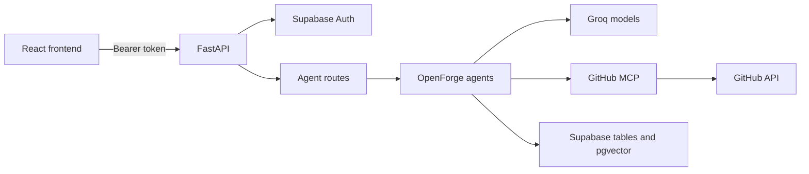

# System Overview

## Components

| Area | Location | Responsibility |
| --- | --- | --- |
| HTTP application | `APP/main.py`, `APP/routes/` | FastAPI app, auth routes, agent routes, health check, and built frontend serving. |
| Web client | `APP/Frontend/` | React/Vite authentication and repository chat workspace. |
| Agents | `Agents/` | Orchestration, mentoring, profile normalization, PR review, repository discovery, documentation, memory, and RAG. |
| Code intelligence | `CODE_intelligence/` | Source parsing and structural analysis used by repository knowledge preparation. |
| GitHub integration | `MCP_server/` | Initializes GitHub MCP tools and filters write-capable tools by configuration. |
| Persistence | `DATABASE/supabase_db.py`, `SUPABASE/` | Supabase Auth validation, user data, sessions, cache, RAG chunks, and graph storage. |
| Model integration | `LLM_gateway/`, agent modules | Groq model configuration and model calls. Most agents instantiate `ChatGroq` directly. |
| Evaluation | `Evalution/`, `TESTS/` | Unit tests, response-contract data, and a live HTTP evaluation runner. |

The repository has both a `LLM_gateway` abstraction and direct `ChatGroq` use in several agents. The active route implementations should be treated as the source of truth for model behavior; the gateway package is not currently a universal layer for every agent call.

## Request flow

1. The frontend submits email/password credentials to `/auth/signup` or `/auth/login`.
2. Supabase returns an access token. The frontend keeps the session in browser `sessionStorage` and sends the access token as a bearer token for protected calls.
3. FastAPI validates that token with Supabase Auth and resolves the user ID.
4. Session-backed agent endpoints verify that the chat belongs to that user.
5. The selected agent calls Groq, Supabase, GitHub MCP, or a combination according to the workflow.
6. Agent turns and application records are persisted through the service-role Supabase client; endpoint responses are returned to the frontend.

## Application entry points

- `APP.main:app` is the ASGI application target.
- `GET /` serves the built frontend. The build output must exist at `APP/Frontend/dist`.
- `GET /health` returns a simple status object and is used by Render's health check.
- FastAPI generates the OpenAPI schema and interactive UI at `/openapi.json` and `/docs`.

## Source layout

- `Agents/orchestrator/`: general contribution chat and prompt construction.
- `Agents/mentor/`: structured contribution guidance grounded in supplied repository context.
- `Agents/profile/`: profile validation and discovery-term preparation.
- `Agents/PR_reviewer/`: diff-based advisory pull-request analysis.
- `Agents/issue_matcher/`: skill-based GitHub repository search and ranking.
- `Agents/documentation_agent.py`: repository documentation generation using GitHub file/tree context.
- `Agents/RAG/`: repository loading, parsing, chunking, embeddings, retrieval, and cited answer generation.
- `Agents/memory/`: shared conversation memory and cached agent responses.
- `Agents/Graph/`: repository knowledge graph representations.

## Frontend/API boundary

The frontend currently calls auth, session, and orchestrator routes. The profile, mentor, PR-review, RAG, documentation, and discovery routes are exposed by the backend but are not currently invoked by the main frontend workflow. Repository context passed by the current UI is an empty string; a caller that needs grounded mentor or orchestrator advice must supply context itself. Repository RAG is a separate indexed-data workflow.